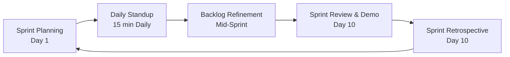
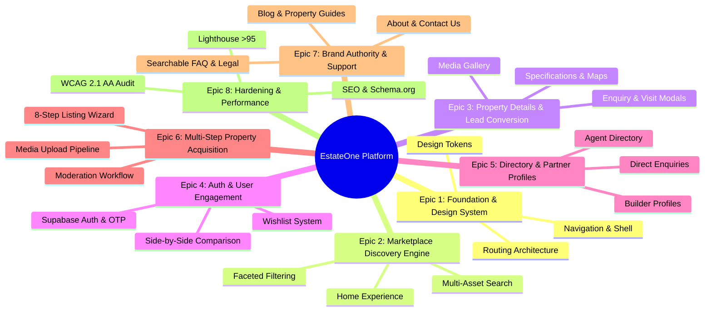
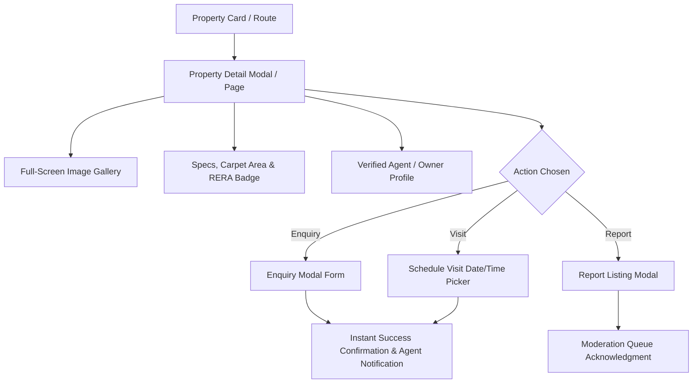
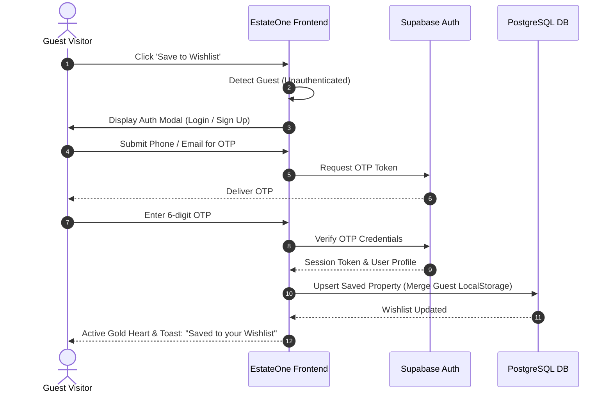
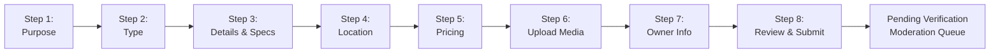
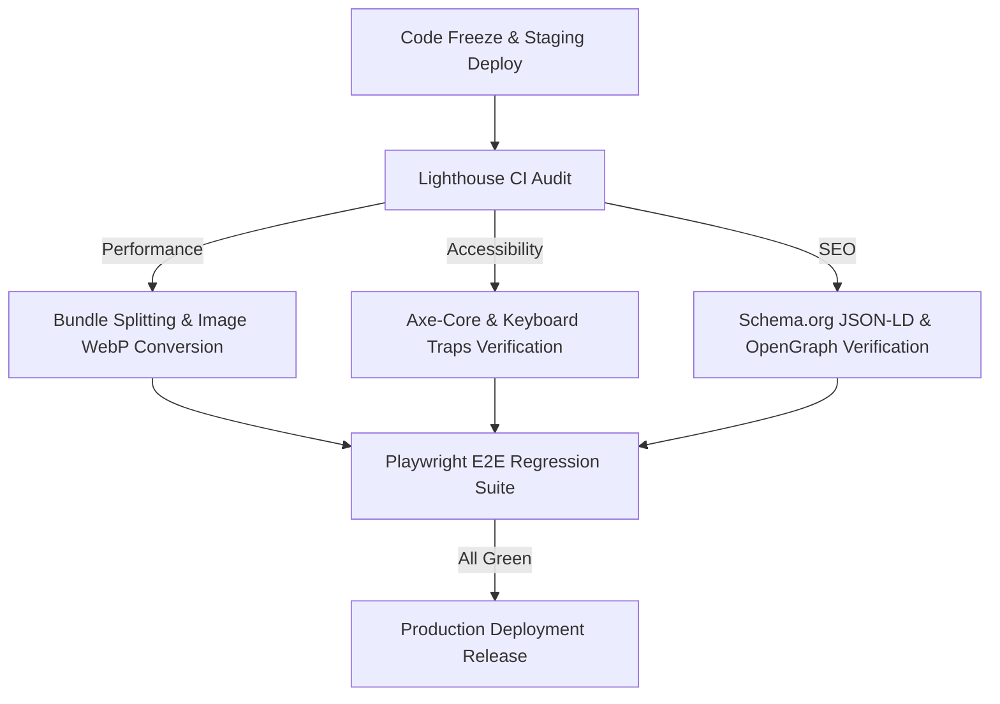
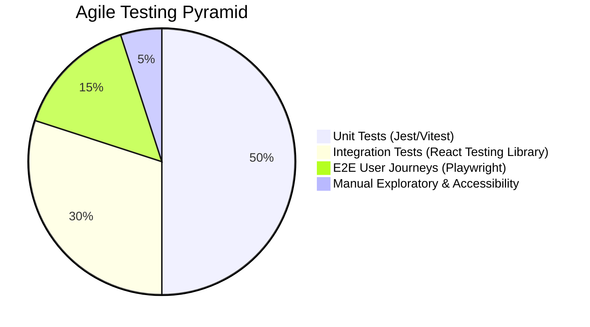
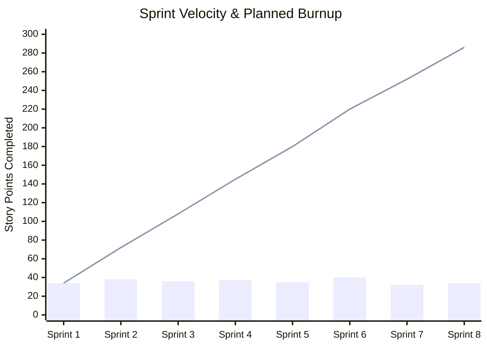

# EstateOne — Public Website Agile Implementation Plan

**Document Version:** 1.0  
**Date:** 18 November 2026  
**Derived From:** [EstateOne Public Website Requirements (PRD v1.0)](file:///e:/WEBSITES/docs/EstateOne_Public_Website_Requirements.md)  
**Target Architecture:** React + Vite, Tailwind CSS, shadcn/ui, Supabase / FastAPI  
**Methodology:** Agile Scrum (2-Week Sprint Cadence across 4 Phases / 8 Sprints)

---

## 1. Executive Summary & Project Vision

EstateOne is a premier, verified real estate marketplace designed to connect property buyers, tenants, owners, agents, and builders through an intuitive, transparent, and trustworthy digital experience. 

### 1.1 Core Business Objectives
1. **Drive High-Intent Lead Conversion:** Convert anonymous visitors into qualified property enquiries, callback requests, and confirmed site visits.
2. **Eliminate Ghost Listings & Friction:** Deliver genuine, verified listings backed by RERA validation, geotagged inspections, and direct seller authorization.
3. **Seamless Discovery Across Asset Classes:** Provide multi-asset search (Residential Buy, Rental, and Commercial Lease/Sale) with synchronized faceted filtering.
4. **Dual Acquisition Channels:** Empower property owners, licensed brokers, and corporate developers to submit listings through a structured 8-step verification wizard.

---

## 2. Agile Framework & Governance Model

The project adheres to the **Agile Scrum** framework organized into 2-week sprints, fostering iterative delivery, early user validation, and continuous quality integration.



### 2.1 Sprint Ceremonies & Rhythm
* **Sprint Planning (Day 1, 2 Hours):** Commit to sprint backlog, review capacity, decompose user stories into technical sub-tasks, confirm story point allocations.
* **Daily Scrum (Daily, 15 Minutes):** Three standard questions: *What was completed yesterday? What is planned today? What blockers exist?*
* **Backlog Refinement (Mid-Sprint, 1 Hour):** Clarify acceptance criteria, estimate upcoming user stories using Planning Poker (Fibonacci scale: 1, 2, 3, 5, 8, 13).
* **Sprint Review / Stakeholder Demo (Day 10, 1 Hour):** Demonstrate working software against the Definition of Done in a live staging environment.
* **Sprint Retrospective (Day 10, 45 Minutes):** Inspect process, celebrate wins, identify bottlenecks, commit to 1–2 actionable improvements for the next sprint.

### 2.2 Agile Roles & Responsibilities
| Role | Primary Ownership |
|---|---|
| **Product Owner (PO)** | Product backlog prioritization, PRD scope clarification, acceptance criteria verification, sign-off on sprint demos. |
| **Scrum Master (SM)** | Facilitates agile ceremonies, removes blockers, tracks velocity, enforces Definition of Done and sprint health metrics. |
| **Frontend Lead** | Architecture of React components, routing, state management, accessibility (WCAG 2.1 AA), responsive layouts. |
| **Backend / Database Lead** | Supabase/PostgreSQL schema, Row Level Security (RLS), FastAPI endpoints, storage policies, rate limiting. |
| **QA / Test Engineer** | Test planning, automated E2E tests (Playwright), cross-browser validation, accessibility/contrast audits. |
| **UI/UX Designer** | Design token adherence, component wireframes, interaction micro-animations, asset handoff. |

### 2.3 Definition of Ready (DoR)
A User Story is **Ready** for sprint commitment when:
1. User story is clearly articulated: *As a [role], I want to [action], so that [business value]*.
2. Acceptance criteria are documented in testable **Given-When-Then** format.
3. UI/UX design specifications, tokens, and responsive breakpoints are finalized.
4. Data contract (API payload schema, error responses) is reviewed by frontend and backend.
5. External dependencies (third-party APIs, asset libraries) are verified and accessible.
6. Story is estimated by the development team and sized at $\le 8$ story points.

### 2.4 Definition of Done (DoD)
A User Story is **Done** when:
1. Feature code is fully implemented meeting all PRD acceptance criteria.
2. Unit and integration tests pass with $\ge 80\%$ branch coverage.
3. Responsive behavior verified across Mobile (375px), Tablet (768px), and Desktop (1280px+).
4. Accessibility compliance verified: keyboard navigability, focus traps in modals, WCAG 2.1 AA contrast, ARIA labels.
5. Zero visible copy hyphens in labels/headings; sentence case typography strictly applied.
6. Code passes ESLint, Prettier, and TypeScript/linter checks without warnings.
7. PR reviewed and approved by at least two senior team members; merged to staging branch.
8. Product Owner verifies in staging and formally signs off.

---

## 3. Product Epics & Requirements Traceability Matrix

The PRD is decomposed into 8 cohesive Epics covering all 22 public routes and cross-page flows:



---

## 4. Release Roadmap & Sprint Schedule

The implementation spans **4 Product Phases** executed across **8 Two-Week Sprints** (16 weeks total):

| Phase | Sprints | Focus Area | Key Outcome |
|---|---|---|---|
| **Phase 1: Core Discovery & Conversion** | Sprints 1–3 | Shell, Search, Listings, Property Details, Enquiries | Visitors discover properties and submit qualified leads |
| **Phase 2: User Engagement & Social Proof** | Sprints 4–5 | Auth, Wishlist, Compare, Agent & Builder Directory | Users register, save properties, compare, and connect with agents |
| **Phase 3: Acquisition & Partner Workflows** | Sprint 6 | Multi-Step Listing Submission Wizard, Media Uploads | Owners & builders submit properties into moderation pipeline |
| **Phase 4: Content, SEO & Hardening** | Sprints 7–8 | Blog, FAQ, Legal, Security, Accessibility, Performance | Production-ready, search-optimized, high-performance platform |

---

## 5. Detailed Sprint-by-Sprint Execution Plan

```mermaid
gantt
    title EstateOne Agile Delivery Timeline
    dateFormat  YYYY-MM-DD
    section Phase 1: Core Discovery
    Sprint 1 : Foundations, Shell & Mock Data        :s1, 2026-11-20, 14d
    Sprint 2 : Marketplace Engine & Faceted Search   :s2, after s1, 14d
    Sprint 3 : Property Details & Conversion Modals :s3, after s2, 14d
    section Phase 2: Engagement
    Sprint 4 : Auth Engine, Wishlist & Comparison   :s4, after s3, 14d
    Sprint 5 : Agent & Builder Directory Ecosystem  :s5, after s4, 14d
    section Phase 3: Acquisition
    Sprint 6 : 8-Step Listing Submission Wizard     :s6, after s5, 14d
    section Phase 4: Hardening
    Sprint 7 : Editorial Blog, Guides, FAQ & Legal  :s7, after s6, 14d
    Sprint 8 : SEO, Accessibility & Launch Readiness:s8, after s7, 14d
```

---

### Sprint 1: Architectural Foundation, Design System & Public Shell
* **Sprint Goal:** Establish repository architecture, complete design system tokens, global navigation, responsive footer, route scaffolding, and unified mock property repository.
* **Velocity Target:** 34 Story Points

#### User Stories & Backlog
1. **US-101: Design Token & Typography System Setup (3 SP)**
   * *As a* developer, *I want* Tailwind configured with the brand palette (`#142B4A`, `#2563EB`, `#C5A46D`, `#F7F8FA`, `#182230`, `#667085`), Manrope, and Geist fonts, *so that* UI consistency is strictly maintained.
   * *Acceptance Criteria:*
     * Given Tailwind configuration, When classes `bg-brand-navy`, `text-brand-gold`, `font-heading`, and `font-body` are used, Then correct hex values and web fonts render.
     * Zero card borders configured (`border-0` with diffused elevations).
2. **US-102: Responsive Global Header & Navigation Drawer (5 SP)**
   * *As a* visitor, *I want* a fixed floating glass header with navigation links, brand logo, and mobile drawer, *so that* I can access any section across devices.
   * *Acceptance Criteria:*
     * Given Desktop view ($\ge 1024$px), When viewing header, Then brand monogram, 5 section links, and "Explore properties" CTA render.
     * Given Mobile view ($<768$px), When clicking menu toggle, Then accessible sheet drawer slides in with touch-friendly links.
     * Given scrolling down, When scrolling past 80px, Then sticky header maintains backdrop blur and saturation.
3. **US-103: Semantic Footer with Structured Links (3 SP)**
   * *As a* visitor, *I want* a comprehensive footer with city links, trust links, and legal disclaimers, *so that* I can navigate to platform policies and authority pages.
   * *Acceptance Criteria:*
     * Given any page footer, Then all links navigate to valid anchors or routes without broken/dead links.
     * Zero hyphens in visible footer copy.
4. **US-104: Route Architecture & Layout Shell (5 SP)**
   * *As a* developer, *I want* client-side routing established with lazy-loaded page containers, *so that* all 22 PRD routes resolve smoothly with shareable URLs.
   * *Acceptance Criteria:*
     * Given any PRD URL (e.g. `/`, `/buy`, `/rent`, `/commercial`, `/compare`), When entered in browser address bar, Then corresponding route container mounts without 404.
5. **US-105: Verified Property Mock Data Model & Factory (5 SP)**
   * *As a* developer, *I want* an expansive, type-safe dataset of verified Indian properties across 6 cities with RERA numbers, specs, pricing, and coordinates, *so that* discovery features have realistic test data.
   * *Acceptance Criteria:*
     * Data model includes: id, slug, title, city, locality, price, priceValue, rentOrSale, propertyType, bedrooms, bathrooms, carpetArea, builtUpArea, reraId, verifiedStatus, amenities, photos, agent details.
6. **US-106: Zero-FOUC Preloader & Skip-to-Content Link (3 SP)**
   * *As an* accessibility-first visitor, *I want* a branded preloader that transitions smoothly to content and an accessible skip link, *so that* initial loading is elegant and accessible.
   * *Acceptance Criteria:*
     * Given page reload, When DOM builds, Then preloader displays SVG monogram and fades out in 500ms without FOUC.
     * Given Tab key pressed on load, When active, Then "Skip to main content" link becomes visible and focuses `<main id="main-content">`.

---

### Sprint 2: Marketplace Engine, Hero Search & Faceted Filtering
* **Sprint Goal:** Build the high-converting Home page, Airbnb-style capsule search, multi-faceted filtering engine, and responsive listing grids for Buy, Rent, and Commercial categories.
* **Velocity Target:** 38 Story Points

#### User Stories & Backlog
1. **US-201: Hero Section & Airbnb Capsule Search Bar (8 SP)**
   * *As a* property seeker, *I want* an iconic capsule search bar with tabs for Buy, Rent, Commercial, and Luxury Villas, *so that* I can quickly search by city, type, budget, and BHK.
   * *Acceptance Criteria:*
     * Given Hero capsule, When switching between Buy/Rent/Commercial tabs, Then budget options and type options update contextually.
     * Given dropdown fields (Where, Type, Price, Rooms), When expanded, Then inputs have transparent borders, zero box-shadow, and responsive options.
     * Given clicking "Explore properties", Then viewport smoothly scrolls to `#properties` with applied search parameters.
2. **US-202: Multi-Faceted Filter Sidebar & Mobile Drawer (8 SP)**
   * *As a* home buyer or tenant, *I want* to filter listings by city, property type, price range, bedrooms, possession status, and verification badge, *so that* I see only relevant properties.
   * *Acceptance Criteria:*
     * Given filter sidebar, When selecting multiple checkboxes, Then listing counter updates immediately in real time.
     * Given Mobile screen, When tapping "Filters", Then full-screen filter sheet opens with "Apply Filters" and "Clear All".
3. **US-203: Active Filter Chips & State Preservation (5 SP)**
   * *As a* user, *I want* applied filters displayed as removable pills above the property grid, *so that* I can see and remove active constraints with a single click.
   * *Acceptance Criteria:*
     * Given active filters, When clicking 'x' on any chip, Then that filter is cleared and grid re-renders.
     * When clicking "Clear all", Then all filters reset to defaults.
4. **US-204: Responsive Borderless Property Cards (5 SP)**
   * *As a* visitor, *I want* high-resolution property cards with verified badges, price tags, carpet area, and quick action buttons, *so that* I can evaluate listings at a glance.
   * *Acceptance Criteria:*
     * Property cards feature: cover image, price, title, locality, BHK/baths, carpet area, verified badge, Save button, and "View details" CTA.
     * Cards use `border-0` with diffused elevations (`shadow-xs` to `shadow-md` on hover).
5. **US-205: Empty & No-Results Feedback States (3 SP)**
   * *As a* user whose search yields zero matches, *I want* a helpful explanation with suggestions to broaden criteria, *so that* I am not left at a dead end.
   * *Acceptance Criteria:*
     * Given 0 matches, Then system displays friendly icon, clear text, and "Reset all filters" button.
6. **US-206: Category Routing for Buy, Rent, and Commercial (5 SP)**
   * *As a* user navigating dedicated categories, *I want* `/buy`, `/rent`, and `/commercial` pages to pre-configure appropriate search contexts and transaction filters, *so that* pricing and specs match the asset class.
   * *Acceptance Criteria:*
     * `/rent` displays monthly rent, deposit range, and furnishing status.
     * `/commercial` displays office/retail/warehouse types and price per sq. ft.
7. **US-207: Sorting & View Controls (4 SP)**
   * *As a* buyer, *I want* to sort results by Price: Low to High, Price: High to Low, Newest First, and Relevance, *so that* I can prioritize listings by my budget.

---

### Sprint 3: Property Details Page & High-Converting Lead Funnels
* **Sprint Goal:** Deliver the comprehensive Property Details view, interactive media gallery, geotagged location specs, and lead conversion modals (Enquiry & Site Visit Scheduler).
* **Velocity Target:** 36 Story Points



#### User Stories & Backlog
1. **US-301: Full-Screen Architectural Image Gallery (5 SP)**
   * *As a* prospective buyer, *I want* to browse high-definition property photographs in a responsive lightbox gallery with thumbnails and image counter, *so that* I can inspect property condition.
   * *Acceptance Criteria:*
     * Given gallery trigger, When clicking on property photo, Then full-screen overlay opens with arrow keys navigation, touch swipe support, and ESC to close.
2. **US-302: Property Specifications & RERA Verification Panel (5 SP)**
   * *As a* buyer, *I want* to review verified carpet area, super built-up area, society maintenance, floor level, and official RERA registry number, *so that* I have legal certainty before contacting.
   * *Acceptance Criteria:*
     * RERA verification card displays state authority (e.g. MahaRERA, Karnataka RERA), registration ID, and direct registry verification link.
3. **US-303: Non-Collapsible Header/Footer Property Detail Modal (8 SP)**
   * *As a* user inspecting listings, *I want* a property detail modal where only the body scrolls while the header and CTA action bar remain fixed, *so that* I never lose access to "Schedule visit" or "Send enquiry".
   * *Acceptance Criteria:*
     * Modal container has fixed header, scrollable body (`overflow-y-auto max-h-[calc(88vh-140px)]`), and fixed bottom action bar.
4. **US-304: Property Enquiry Form & Lead Capture (5 SP)**
   * *As an* interested buyer or tenant, *I want* to submit my name, verified phone number, email, and query message, *so that* the verified seller or agent contacts me directly.
   * *Acceptance Criteria:*
     * Form validates: 10-digit Indian phone number, valid email, non-empty name, and privacy consent checkbox.
     * Prevents duplicate submissions while request is in flight.
     * Displays success confirmation with estimated response time (<2 hours).
5. **US-305: Site Visit Scheduling Modal (8 SP)**
   * *As a* qualified buyer, *I want* to select an available inspection date and time slot (Morning, Afternoon, Evening) for an in-person or virtual walkthrough, *so that* I can tour the home.
   * *Acceptance Criteria:*
     * Date picker disables past dates and limits selection to the next 14 days.
     * Time slot pills allow single selection.
     * Confirmation displays booked property, scheduled date/time, and appointment reference code.
6. **US-306: Report Inaccurate / Duplicate Listing Modal (3 SP)**
   * *As a* community visitor, *I want* to report inaccurate pricing, sold out inventory, or broker spam, *so that* EstateOne moderators can audit the listing.
   * *Acceptance Criteria:*
     * Dropdown reasons: Incorrect details, already sold/rented, fake photos, suspected broker fraud.
     * Submission logs event to moderation audit table with confirmation acknowledgment.
7. **US-307: Similar Verified Properties Carousel (2 SP)**
   * *As a* browser, *I want* to see 3–4 similar properties in the same city and budget range at the bottom of the details page, *so that* I can continue exploring alternatives.

---

### Sprint 4: Authentication Engine, Wishlist & Comparison Matrix
* **Sprint Goal:** Implement Supabase Auth (Email + OTP), persistent Wishlist with guest session migration, and the 4-property side-by-side comparison matrix.
* **Velocity Target:** 37 Story Points



#### User Stories & Backlog
1. **US-401: Authentication Modal & Protected Action Route Guard (8 SP)**
   * *As a* visitor attempting to save a property or submit a listing, *I want* to authenticate via phone/email OTP or password without losing my current page context, *so that* I can complete my intended action.
   * *Acceptance Criteria:*
     * Modal supports Login, Sign-up, Forgot Password, and OTP verification views.
     * Upon successful authentication, user is returned to the exact property or action they initiated.
2. **US-402: Guest & Authenticated Wishlist Engine (5 SP)**
   * *As a* property seeker, *I want* to save properties to my favorites list, *so that* I can review and compare them later.
   * *Acceptance Criteria:*
     * Guests store saved IDs in `localStorage`.
     * Upon login, local wishlist merges with user's Supabase account without duplicate entries.
     * Heart icon updates reactively across all cards and modal headers.
3. **US-403: Dedicated Saved Properties Page (`/saved-properties`) (5 SP)**
   * *As a* registered user, *I want* a dedicated dashboard page listing all my shortlisted properties with filters and remove actions, *so that* I can manage my shortlists.
   * *Acceptance Criteria:*
     * Supports one-click remove, direct enquiry, and quick add-to-compare.
     * Displays empty state when zero saved properties exist with CTA "Explore properties".
4. **US-404: Floating Comparison Tray & Counter (5 SP)**
   * *As a* user browsing multiple listings, *I want* an unobtrusive floating bottom tray showing up to 4 selected properties, *so that* I can launch a comparison at any time.
   * *Acceptance Criteria:*
     * Adding 5th property triggers toast notification: "Maximum 4 properties can be compared simultaneously".
     * Shows thumbnails, titles, prices, remove buttons, and "Compare now" button.
5. **US-405: Side-by-Side Comparison Matrix Page (`/compare`) (8 SP)**
   * *As a* discerning buyer, *I want* a comprehensive side-by-side comparison table evaluating Price, Carpet Area, Rate per Sq. Ft., Bedrooms, Bathrooms, Facing, Amenities, and RERA status, *so that* I can make an informed decision.
   * *Acceptance Criteria:*
     * Matrix displays synchronized horizontal scrolling on mobile/tablet.
     * Features diff-highlighting for differing specifications.
     * Direct "Schedule visit" and "Contact agent" CTAs beneath each compared column.
6. **US-406: Password Reset & OTP Expiry Lifecycle (4 SP)**
   * *As a* user who forgot their password, *I want* to request a secure reset link with 10-minute expiry and resend rate-limiting, *so that* my account security is preserved.
   * *Acceptance Criteria:*
     * OTP inputs support auto-focus transfer across 6 digit boxes.
     * Resend button has 60-second cooldown timer.
     * Generic success message prevents account enumeration attacks.
7. **US-407: User Profile & Session Persistence (2 SP)**
   * *As a* registered buyer, *I want* my session kept active across browser tabs and my contact details pre-filled in enquiry forms, *so that* booking visits is effortless.

---

### Sprint 5: Professional Directory, Builders & Agent Profiles
* **Sprint Goal:** Implement the Agents and Builders searchable directory, verified profile pages, agency credentials, active portfolio listings, and direct advisor contact forms.
* **Velocity Target:** 35 Story Points

#### User Stories & Backlog
1. **US-501: Agents & Builders Searchable Directory (`/agents`, `/builders`) (8 SP)**
   * *As a* property seeker or investor, *I want* to browse accredited real estate advisors and RERA-registered developers filtered by city, specialization, and customer ratings, *so that* I can partner with reputable experts.
   * *Acceptance Criteria:*
     * Search bar filters by agent/builder name, company, or locality.
     * Filter chips for Residential Luxury, Commercial, Rental Specialists, New Developments.
     * Cards display: portrait, name, agency, RERA license, experience years, active listings count.
2. **US-502: Detailed Agent & Builder Profile Pages (`/agents/:slug`) (8 SP)**
   * *As a* prospective client, *I want* to view an agent's bio, operating zones, language proficiencies, licensed credentials, and active listings, *so that* I can assess their track record.
   * *Acceptance Criteria:*
     * Profile header features verified trust seal, direct contact actions, and company affiliations.
     * Tabbed view for: "Active Listings" (rendered using standard property cards) and "About & Credentials".
3. **US-503: Direct Advisor Consultation Enquiry Modal (5 SP)**
   * *As a* high-net-worth buyer, *I want* to send a direct advisory request to a specific agent with my preferred property type and budget, *so that* they can curate off-market options for me.
   * *Acceptance Criteria:*
     * Pre-assigns the target agent ID to the generated lead record.
     * Privacy consent disclaimer explicitly notes data is shared solely with the requested partner.
4. **US-504: Builder Project Portfolio Showcase (8 SP)**
   * *As an* investor, *I want* to view a builder's ongoing, ready-to-move, and upcoming developments with master layout plans and sanctioned permits, *so that* I can evaluate builder credibility.
   * *Acceptance Criteria:*
     * Displays project timeline status: Under Construction, Ready to Move, Pre-launch.
     * Links directly to individual project unit listings.
5. **US-505: RERA Agent Registry Validation Display (4 SP)**
   * *As a* legally conscious buyer, *I want* to see the official state RERA individual or corporate registration number for all agents, *so that* I am protected from illegal brokerage practices.
   * *Acceptance Criteria:*
     * License badge displays clickable external link to state RERA portal verification check.
6. **US-506: Empty State & Lead Routing Fallbacks (2 SP)**
   * *As a* visitor filtering for agents in a tier-2 locality with zero matches, *I want* to submit a general consultation request, *so that* EstateOne's central advisory team can support me.

---

### Sprint 6: Multi-Step Property Acquisition & Media Upload Wizard
* **Sprint Goal:** Build the 8-step property listing wizard (`/list-property`), media upload pipeline with validation, listing preview, and moderation submission lifecycle.
* **Velocity Target:** 40 Story Points



#### User Stories & Backlog
1. **US-601: Wizard Container, Stepper Navigation & Draft Storage (8 SP)**
   * *As a* property owner or agent, *I want* an 8-step wizard with visual progress tracking, step validation, and local draft auto-saving, *so that* I can complete my property submission without losing progress.
   * *Acceptance Criteria:*
     * Stepper bar displays steps 1 to 8 with completed checkmarks and current step highlight.
     * "Previous" and "Next" buttons preserve all entered data in state and `localStorage`.
     * Next step is blocked if current step required fields fail validation.
2. **US-602: Steps 1 & 2 — Listing Purpose & Property Category (3 SP)**
   * *As a* seller, *I want* to select whether I am selling, renting, or leasing an Apartment, Villa, Independent House, Plot, or Commercial Space, *so that* the subsequent form customizes its fields.
   * *Acceptance Criteria:*
     * Visual selectable cards for Sell, Rent, Lease.
     * Secondary grid for residential vs commercial property types.
3. **US-603: Step 3 — Architectural Specifications & Amenities (5 SP)**
   * *As a* listing submitter, *I want* to enter bedrooms, bathrooms, carpet area (sq. ft.), super area, furnishing status, floor number, total floors, property age, and select amenities, *so that* buyers have exact specs.
   * *Acceptance Criteria:*
     * Number steppers for bedrooms/bathrooms.
     * Checkbox grid for amenities (Power backup, Security, Club house, Swimming pool, etc.).
4. **US-604: Step 4 — Geographic Location & Locality Details (5 SP)**
   * *As a* seller, *I want* to specify State, City, Locality, Postal Code, and full street address, *so that* the property can be accurately mapped and verified.
   * *Acceptance Criteria:*
     * City dropdown linked to supported market list.
     * Locality autocomplete field with landmark notes.
5. **US-605: Step 5 — Upfront Pricing Breakdown (5 SP)**
   * *As an* owner, *I want* to enter expected price/monthly rent, security deposit, maintenance charges, and mark whether the price is negotiable, *so that* buyers receive transparent numbers.
   * *Acceptance Criteria:*
     * Real-time Indian currency formatter (e.g. ₹1,50,00,000 / ₹1.5 Cr).
     * Clear separation of base price, monthly maintenance, and registration estimates.
6. **US-606: Step 6 — Media Upload Pipeline & Photo Preview (8 SP)**
   * *As a* submitter, *I want* to drag and drop multiple property photos and floor plans, set a primary cover photo, and reorder images, *so that* my listing is visually compelling.
   * *Acceptance Criteria:*
     * Accepts JPEG, PNG, WebP up to 10MB per file; maximum 20 photos.
     * Rejects non-image files with clear error toast.
     * Thumbnail previews with "Set as cover" and "Delete" actions.
7. **US-607: Step 7 — Ownership Credentials & Direct Authorization (3 SP)**
   * *As an* applicant, *I want* to confirm whether I am the direct Title Deed Owner, Authorized Agent, or Developer Representative and provide my RERA number, *so that* listings meet verification standards.
8. **US-608: Step 8 — Comprehensive Review, Terms & Submission (3 SP)**
   * *As a* submitter, *I want* to review a full composite preview of my listing, accept listing terms, and submit for verification, *so that* I can double-check accuracy before handoff.
   * *Acceptance Criteria:*
     * Shows a clean summary of all 7 previous sections with "Edit" jump links.
     * Displays submission confirmation with reference ID (e.g. `PROP-SUB-2026-9842`) and next steps: "Under physical and RERA registry review (24–48 hours)".

---

### Sprint 7: Brand Authority, Editorial Hub & Support Ecosystem
* **Sprint Goal:** Complete the supporting ecosystem: About Us, Contact Us with categorization, Editorial Blog & Property Guides, Searchable FAQ, and verified Legal/Compliance pages.
* **Velocity Target:** 32 Story Points

#### User Stories & Backlog
1. **US-701: About Us Brand Story & Verification Methodology (`/about`) (5 SP)**
   * *As a* visitor, *I want* to learn about EstateOne's mission, leadership principles, zero-ghost-listing philosophy, and 3-tier inspection protocol, *so that* I trust the brand.
   * *Acceptance Criteria:*
     * Clear demonstrative disclaimer if presented in portfolio context.
     * Responsive sections for Mission, Vision, RERA standards, and Leadership values.
2. **US-702: Contact Us Page with Routing Categories (`/contact`) (5 SP)**
   * *As a* customer or partner, *I want* a categorized contact form (General, Buying, Renting, Listing, Builder Partnership, Technical), *so that* my enquiry reaches the correct department.
   * *Acceptance Criteria:*
     * Form validates name, email, phone, category, and message.
     * Displays physical headquarter address in BKC Mumbai, contact email, and priority phone line.
3. **US-703: Real Estate Editorial Hub & Guides (`/blog`, `/blog/:slug`) (8 SP)**
   * *As a* home buyer, *I want* to read property guides on home loans, stamp duty calculations, RERA rights, and city neighborhood spotlights, *so that* I make educated decisions.
   * *Acceptance Criteria:*
     * Category filter pills: Buying Guides, Renting Tips, Legal & RERA, Market Insights.
     * Article view displays read-time, author badge, table of contents, and social share actions.
4. **US-704: Interactive Searchable FAQ Accordion (`/faq`) (5 SP)**
   * *As a* user, *I want* a searchable FAQ accordion categorized by Verification, Fees, Site Visits, and Selling, *so that* I get immediate answers to common questions.
   * *Acceptance Criteria:*
     * Live search input filters questions in real time.
     * Accessible shadcn/ui Accordion with keyboard arrow navigation.
5. **US-705: Legal Hub — Privacy Policy & Terms of Service (`/privacy-policy`, `/terms-and-conditions`) (5 SP)**
   * *As a* user, *I want* clear legal documentation detailing data usage, RERA disclaimers, cookie compliance, and dispute resolution, *so that* my privacy rights are transparent.
   * *Acceptance Criteria:*
     * Covers: data sharing with verified owners, SMS/WhatsApp consent rules, platform disclaimers.
     * Formatted in semantic Markdown with anchored section navigation.
6. **US-706: Custom Branded 404 & Error Boundary Recovery (4 SP)**
   * *As a* user who clicks an outdated or broken link, *I want* a helpful 404 page with search shortcuts back to popular cities, *so that* I am not stranded.
   * *Acceptance Criteria:*
     * Clean layout with "Back to Home", "Browse Buy Properties", and "Explore Cities" buttons.

---

### Sprint 8: Accessibility Audit, SEO Architecture, Performance & Release Readiness
* **Sprint Goal:** Conduct comprehensive WCAG 2.1 AA accessibility audits, inject Schema.org JSON-LD microdata, optimize Core Web Vitals to Lighthouse $\ge 95$, and execute full E2E test runs.
* **Velocity Target:** 34 Story Points



#### User Stories & Backlog
1. **US-801: Automated E2E Regression Test Suite (Playwright) (8 SP)**
   * *As a* QA engineer, *I want* automated end-to-end regression tests covering the 5 primary user journeys (Buyer, Tenant, Commercial, Owner Listing, Agent Contact), *so that* regressions are caught prior to production deployment.
   * *Acceptance Criteria:*
     * Tests pass headless in CI pipeline for Chrome, Firefox, and Mobile Safari.
     * Validates: search & filter, open details modal, fill enquiry form, submit listing wizard.
2. **US-802: Full WCAG 2.1 AA Accessibility Hardening (8 SP)**
   * *As a* user with motor or visual impairments, *I want* complete keyboard navigation, visible focus rings, proper ARIA roles, and high-contrast text, *so that* the site is fully usable.
   * *Acceptance Criteria:*
     * Axe-core audit reports zero critical or serious accessibility violations.
     * Tab navigation cycles logically through all forms, modals trap focus properly.
     * All buttons and icon-only triggers possess explicit `aria-label` attributes.
3. **US-803: Semantic SEO, JSON-LD Schema & Meta Tags (5 SP)**
   * *As an* organic discovery marketer, *I want* dynamic OpenGraph tags, canonical links, and `RealEstateListing` + `FAQPage` JSON-LD schemas, *so that* search engines index properties accurately.
   * *Acceptance Criteria:*
     * Every property page renders valid Schema.org `RealEstateListing` microdata.
     * Google Rich Results test validates structured data without errors.
4. **US-804: Core Web Vitals & Asset Optimization (5 SP)**
   * *As a* mobile user on a 4G connection, *I want* page loads in $<1.5$ seconds with zero layout shift, *so that* my browsing experience is fast and responsive.
   * *Acceptance Criteria:*
     * Largest Contentful Paint (LCP) $\le 1.8$s, Cumulative Layout Shift (CLS) $\le 0.05$.
     * Images lazy-loaded and delivered via modern WebP formats with explicit width/height.
     * Lighthouse scores $\ge 95$ across Performance, Accessibility, Best Practices, and SEO.
5. **US-805: Security, Rate Limiting & OWASP Compliance (5 SP)**
   * *As a* platform administrator, *I want* rate-limiting on lead forms, CSRF protection, input sanitization against XSS, and secure headers, *so that* malicious bots cannot abuse the platform.
   * *Acceptance Criteria:*
     * Enquiry and contact endpoints limit submissions to 5 requests per IP per 10 minutes.
     * Content Security Policy (CSP) headers configured; all form inputs sanitized.
6. **US-806: Final Stakeholder Sign-Off & Production Deployment (3 SP)**
   * *As the* Product Owner, *I want* to verify the end-to-end staging environment against all 14 PRD Acceptance Criteria categories, *so that* the public website can be officially launched.

---

## 6. Agile Quality Engineering & Testing Strategy



### 6.1 Testing Levels & Tooling
* **Unit Testing (Vitest):** Form validation routines, price formatters, filter combination logic, date helpers.
* **Component Testing (React Testing Library):** Property card rendering, modal open/close behaviors, active filter chip removal, accordion expands.
* **End-to-End Testing (Playwright):**
  * `buyer-journey.spec.js`: Home &rarr; Capsule Search &rarr; Filter &rarr; Open Property &rarr; Send Enquiry &rarr; Confirmation.
  * `visit-scheduling.spec.js`: Property &rarr; Schedule Visit &rarr; Date Picker &rarr; Time Slot &rarr; Submit &rarr; Confirmation.
  * `listing-wizard.spec.js`: `/list-property` &rarr; Steps 1–8 &rarr; Media Upload &rarr; Review &rarr; Pending Verification.
  * `compare-flow.spec.js`: Add 4 properties &rarr; View `/compare` &rarr; Verify matrix &rarr; Remove 1 &rarr; Add alternative.
* **Accessibility Audits (Axe-core, Lighthouse, Screen Reader):** NVDA / VoiceOver manual checks, automated CI Axe checks.

---

## 7. Agile Risk Management & Mitigation Matrix

| # | Identified Risk | Impact | Probability | Mitigation Strategy |
|---|---|---|---|---|
| **R-1** | **Scope Creep in Listing Wizard:** 8 steps might overwhelm users or prolong delivery. | High | Medium | Implement local draft saving; deliver minimal viable wizard first; defer complex floor plan 3D integrations to post-launch. |
| **R-2** | **Third-Party Map / Geocoding Costs:** Unbounded Google Maps API queries. | Medium | High | Cache geocoded localities at database level; use static map snapshots for card previews; load dynamic map only on property detail view. |
| **R-3** | **Unauthenticated Enquiry Spam:** Automated bots flooding verified agents. | High | High | Implement hidden honeypot fields, Cloudflare Turnstile rate-limiting, and 10-digit Indian mobile format regex validation. |
| **R-4** | **Image Upload Failures:** Large raw photos causing upload timeouts or layout breakage. | High | Medium | Client-side Canvas image resizing before upload; restrict to 10MB; display animated upload progress bar with retry hooks. |
| **R-5** | **FOUC on First Contentful Paint:** Flash of unstyled text or raw icons before CSS load. | Medium | Low | Critical CSS and inline SVG monogram embedded directly into `index.html` with graceful React hydration fade-out. |

---

## 8. Team Velocity & Milestone Tracking

* **Target Velocity:** 36 Story Points per 2-week Sprint.
* **Total Estimated Backlog:** 286 Story Points.
* **Project Duration:** 8 Sprints (16 Weeks).



### Milestone Review Gates
* **Milestone 1 (End of Sprint 3 — Week 6):** Core Discovery Engine & Lead Generation Live on Staging. Stakeholder demo of Search, Filter, Details & Enquiry.
* **Milestone 2 (End of Sprint 5 — Week 10):** User Engagement, Wishlist, Compare & Agent Directory Live. Beta testing with internal agents.
* **Milestone 3 (End of Sprint 6 — Week 12):** Property Acquisition Pipeline Complete. Listing submission wizard handoff to moderation tested.
* **Milestone 4 (End of Sprint 8 — Week 16):** Final Hardened Release. SEO, WCAG 2.1 AA certified, Lighthouse 95+, Production Deployment.

---

## 9. Next Steps for Immediate Sprint 1 Execution

1. **Sprint 1 Kickoff:** Review US-101 through US-106 with engineering team.
2. **Environment Setup:** Confirm Supabase project staging credentials, storage buckets (`property-media`), and environment secrets.
3. **Branching Strategy:** Enforce `main` (production), `develop` (staging), and `feature/US-[id]-[description]` git flow with required PR checks.
4. **Daily Standup Cadence:** Establish daily 09:30 AM IST sync on project message board.
